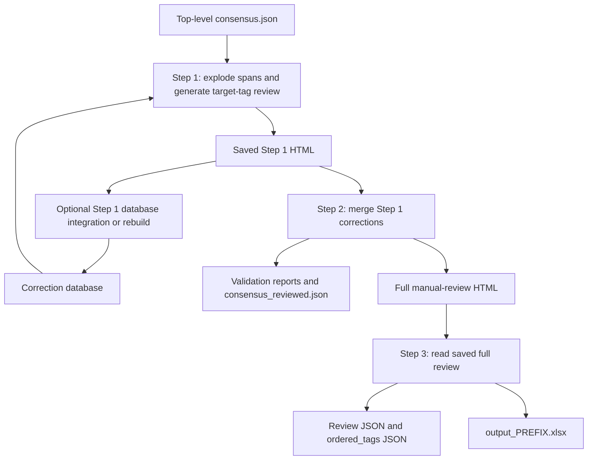

# Pipeline

The two runtime entry points are `run.py` (AI coding and comparison) and `run_post_processing.py` (AI-free manual review and export). Configuration is imported from Python files; these scripts do not expose command-line options for selecting prefixes, run types, or steps.

## Main run

From the repository root:

```bash
uv run python run.py
```

`run.py::_run_main_pipeline()`:

1. Discovers transcript paths using `run_scope.find_source_documents(RUN_TYPE)`.
2. Scans every `TXT_FILES` subfolder (one whole document per stem, `full/` first) to extract ATLAS quote text if its column is missing or entirely empty. This can rewrite the human Excel input in place.
3. Loads tag definitions and optionally runs each AI configuration for its configured iteration count. `RUN_AI_CODING=False` skips classification calls; existing iteration JSON is still needed.
4. Loads human quotes and AI runs separately, aligning their mappings to the discovered document names. Builds `Document` / `Row` objects from the transcript files.
5. Builds cumulative character-level consensuses for iterations `0..k`, then takes each configuration's final consensus. Each character/tag is retained when its vote fraction is `>= consensus_threshold`.
6. Builds a superconsensus over final configuration consensuses, each configuration having equal weight. With one configuration this has the same character labels; with none there is no prediction data.
7. Writes per-configuration and top-level `consensus.json` files under `data/results/{PREFIX}/{RUN_TYPE}/1-ai_coding/`. A single-iteration configuration exports its original iteration quotes directly; with exactly one configuration the top-level file copies those exported records. With multiple configurations the top-level file contains the voted superconsensus.
8. Reloads the consensus sources selected by `HTML_CONSENSUS_CONFIGURATIONS` for rendering: empty means the top-level file; otherwise each listed configuration gets its own column. Records with unresolved spans are skipped by the consensus loader.
9. For each report scope, calculates iteration, final consensus, superconsensus, and consensus-progression metrics. It also calculates per-tag span analysis and superconsensus tag confusion.
10. Writes metrics workbooks including undefined tags and, when enabled, excluding them. The primary including workbook's `comparison` sheet can import overview rows from `COMPARISON_PREFIXES` with the same run type and scope.
11. Renders the HTML comparison and opens the primary report in the default browser.

Metrics use in-memory voted consensuses; HTML uses the exported/reloaded consensus files. In particular, single-iteration JSON preserves original quote boundaries while character voting can split/merge spans. The two representations need not have identical tag-sequence or span-count metrics even when their character labels agree.

## Run types and scopes

`src/dataset/run_scope.py` discovers files on disk; it does not rerun selection from `output.xlsx`. Preparation is a separate manual step described in [Data Loading](data-loading.md#preparing-the-dataset).

| `RUN_TYPE` | Processing directory | Report document names |
| --- | --- | --- |
| `training` | `TXT_FILES/training` | Training folder's `.txt` stems |
| `validation` | `TXT_FILES/validation` | Validation folder's `.txt` stems |
| `test` | `TXT_FILES/test` | Manually supplied test `.txt` stems |
| `full_without_validation` | `TXT_FILES/full_without_validation` | Training folder's `.txt` stems only |
| `full` | `TXT_FILES/training`, `validation` and `full`, one file per stem | Three scopes: training, validation, combined union of their stems |

Scope names are found from direct `*.txt` children of the subset folders, while processing discovery is recursive. For `full`, `run_scope.find_source_documents()` collects the three folders in that order and keeps only the first file for each stem, so a document that exists in `training/` and `full/` is coded once. `full_without_validation/` and `test/` are not part of a `full` run. Untagged full-dataset documents are processed but do not enter the combined report unless their stems appear in training or validation.

Repeated stems are not given separate identities: loaded documents are keyed by stem, and AI classifications are written to one file per stem per iteration. Different content under the same stem can overwrite/collide, especially when full, filtered, and test copies coexist. The pipeline does not verify that copies agree. Its report selection also slices by document name, not by the source spreadsheet's selected rows.

## Output paths

Single-scope reports use:

```text
data/results/{PREFIX}/{RUN_TYPE}/2-results/comparison_interface_{PREFIX}.html
data/results/{PREFIX}/{RUN_TYPE}/2-results/configuration_matrix_main_{PREFIX}_including_undefined_tags.xlsx
data/results/{PREFIX}/{RUN_TYPE}/2-results/configuration_matrix_main_{PREFIX}_excluding_undefined_tags.xlsx
```

The excluding workbook exists only with `UNDEFINED_TAGS_ENABLED=True`. `full` adds `_{scope}` after the prefix, for example `configuration_matrix_main_{PREFIX}_combined_including_undefined_tags.xlsx`; `combined` is the primary report used for browser opening and cross-prefix comparisons.

AI iteration output, consensus files, and prompt snapshots (`prompt_{condition-slug}[__unused].txt`) live under `data/results/{PREFIX}/{RUN_TYPE}/1-ai_coding/`. See [AI Coding](ai-coding.md) for call behavior, metadata, and cost files.

## Post-processing

Keep `PREFIX` and `RUN_TYPE` aligned with the source AI run. Choose one `POST_PROCESS_STEP` in `src/config/post_processing.py` and run:

```bash
uv run python run_post_processing.py
```

Run steps 1, 2, and 3 separately, saving browser edits between steps. Every step uses `run_scope.find_source_documents(RUN_TYPE)`; post-processing does not apply the main pipeline's report-scope slicing.



All step folders sit under `data/results/{PREFIX}/{RUN_TYPE}/3-post_process/`.

### Step 1: target-tag review and correction database

`run_step1()` loads the top-level `consensus.json`, splits every multi-tag span into separate single-tag records, and writes `01_undefined_tags/consensus_unmodified.json`. This exploded representation is the baseline for review and Step 2.

`build_target_tags()` combines `POST_PROCESS_TAGS` (currently `other`) with observed undefined tags when `POST_PROCESS_INCLUDE_UNDEFINED_TAGS=True`. `build_step1_target_records()` retains every record in paragraphs containing a target, including non-target records for context. It sets `is_target` and `raw_tag` before database prefill. The generated `review_interface_undefined_tags_{PREFIX}.html` defaults to editing target occurrences only; disabling its restriction allows editing non-target records, but adding new spans remains disabled in this mode.

`POST_PROCESS_LOAD_DATABASE` prefills matching target records. A multi-tag correction creates sibling records; a deletion marks the occurrence deleted. Retag suggestions keep their original status until edited. The correction workbook is `01_undefined_tags/database_{PREFIX}.xlsx`, with a single `data` sheet; it is created when corrections are saved, not just by generating a review page.

#### Rerunning Step 1

`handle_existing_step1_review()` reads the **saved** previous page before rebuilding anything:

| Existing page / configuration | Action |
| --- | --- |
| No saved review page | Generate a page regardless of the integration flag or whether a database exists. |
| Saved `protect_file=True` | Optionally integrate corrections if enabled, then stop. No database rebuild or page overwrite. |
| `POST_PROCESS_STEP1_REBUILD_DATABASE=True` | Ask confirmation, delete/repopulate the current database from resolved target records, then **stop**. |
| `POST_PROCESS_STEP1_INTEGRATE_INTO_DATABASE=True` | Merge resolved target records into the database, then **stop**. |
| None of those, but resolved target records exist | Ask before discarding them and regenerating the page. |
| No resolved target records | Regenerate without that overwrite prompt. |

To render a fresh page after a database-only operation, turn its switch off and rerun Step 1, respecting the existing page's protection/overwrite decision. Database integration is optional for Step 2; Step 2 reads the saved HTML directly.

The integration flag can remain `True` for an initial run with no saved review page. Set it to `False` when test decisions should not be saved, or when regenerating an existing page. Database existence does not control this branch: importing saved corrections creates the database if needed, and an import with no corrections writes no database file but still stops when a review page exists.

A database resolution is a target record retagged relative to `raw_tag`, or deleted. A moved-only record is not saved as a database correction, and non-target edits are not integrated. Prefilled resolutions can also be saved through this adapter.

#### Matching and conflict resolution

Database matching uses document identity plus span intersection-over-union of at least `POST_PROCESS_SPAN_OVERLAP_THRESHOLD` (currently `0.9`). It compares absolute document spans, so reuse assumes consistent transcript coordinates.

A record's original `ai_tag` decides which entries apply. If the database holds an entry for the record's own `ai_tag` on that span, only those entries are used, so the records of a double-coded span are prefilled independently. Without one, any correction of the span applies, so a correction is still reused when a later run or model labelled the same phrase with a different tag.

When a reviewer corrects one record of a double-coded span, the other target records of that span that were left unchanged are saved as *kept* rows (`new_tag` equals `ai_tag`). A kept row stops the sibling's correction from being applied to the unchanged record. It is replaced when the same `ai_tag` later gets a real decision, never conflicts with other entries, and is not counted in the "Saved N manually defined tag(s)" message.

- Saving skips identical resolved tags, replaces incompatible tags, and keeps compatible tags alongside each other. Two tags are incompatible only when both disallow double coding.
- Prefill combines compatible names alphabetically. Among conflicting non-double-codable tags, the one from the most recently modified database file wins.
- The reserved value `<deleted>` removes conflicting entries when saved and wins over any tag suggestions during prefill.
- With `POST_PROCESS_DATABASE_USE_ALL_PREFIXES=True`, lookup scans all prefixes **and all run types** beneath `DATA_RESULTS_DIR` (`data/results/*/*/3-post_process/01_undefined_tags/`); otherwise it reads only the current database.

Random cluster files lack a full document identity and are skipped for database matching.

### Step 2: close out Step 1 and generate full review

`run_step2()` has two phases:

1. **Close Step 1:** load `consensus_unmodified.json` and saved Step 1 HTML records. `build_corrected_consensus()` replaces each represented paragraph wholesale with its saved records, preserving non-target edits too; other paragraphs pass through. Deleted records are dropped when records are collapsed back into multi-tag spans. Write `01_undefined_tags/consensus_with_defined_tags.json`. With no extracted records, the baseline passes through. Target outcomes and edited non-target outcomes are logged and appended to the including validation workbook as `step1_review_outcomes` when present.
2. **Build supervision outputs:** copy that corrected file to `02_manual_supervision/consensus.json`, reload it, log co-occurrence conflicts and remaining undefined tags, and write `consensus_reviewed.json`. Generate `review_interface_general_{PREFIX}.html`, `comparison_interface_pp2_{PREFIX}.html`, and `configuration_matrix_pp2_{PREFIX}_including_undefined_tags.xlsx`, plus the excluding workbook when enabled.

Despite its name, `consensus_reviewed.json` is the **input to the full review page after Step 1 corrections**. Step 2 does not read edits from its existing full review HTML into that JSON or its reports. Step 3 consumes those saved full-review edits; it does not regenerate Step 2 validation metrics.

Saved `protect_file=True` prevents regeneration of the full review HTML only. The consensus copies and reports are still regenerated from Step 1, so a protected page and newly generated reports can represent different states. Without protection, the page is rebuilt from the corrected consensus; previous full-review tag edits are not merged back.

### Saving and review controls

Both review pages use `src/templates/manual_review.html` with embedded JSON and require no server. The reviewer can retag, move a span within its paragraph, delete/restore tags, and—in full mode—add tags. Free-text tag entry is allowed; the suggestion list does not enforce the codebook.

- Marking a paragraph reviewed locks its annotations until unchecked.
- Clicking a tag badge scrolls to its text and briefly outlines all spans belonging to that occurrence. Editable tags also open the editor; locked tags still highlight their text.
- Marking it excluded locks and greys it out, and counts as reviewed. Step 3 removes rows marked excluded in the **Step 2 page** from the Excel export. Step 1 exclusion flags are not transferred to Step 2 by the record merge.
- On regenerating either page, existing exclusions from that same file can be copied after console confirmation; ordinary reviewed checks start fresh.
- Metadata and identity filters, tag visibility, and system-tag visibility affect the page view. System tags are hidden by default.
- Edits autosave to browser local storage for restoration, but Python reads the HTML on disk. Use the page's Save button and save at its configured path. Where direct file saving is unavailable, replace the original file with the downloaded copy.
- The page's protection flag must also be saved to disk before Python can honor it. Step 3 reads the page regardless of protection.

Old XLSX-based Step 1 extraction files and old-schema review HTML are not migrated or used as review inputs.

### Step 3: export the saved full review

`run_step3()` writes into `03_export/`:

1. With `POST_PROCESS_STEP3_USE_EXISTING_JSON=False`, read saved Step 2 HTML. Ask for confirmation if any paragraph is neither reviewed nor excluded; declining stops before Step 3 data outputs are written. Collapse edited records and write `manual_review_{PREFIX}.json` as `{"consensus_rows": [...], "excluded_paragraphs": [[source_name, row], ...]}`. With the setting `True`, require and reuse that JSON; skip HTML extraction and the review-completion check. A legacy bare list of consensus records is also accepted, with no exclusions.
2. Always rebuild `ordered_tags_{PREFIX}.json`. Each identifiable document row gets `{"source_name", "identity", "row", "display_value", "tags", "excluded"}`. Sort spans by start, then shortest length; on the same span put non-double-codable tags first, followed by deterministically shuffled co-occurring tags seeded from paragraph and phrase text. Excluded rows remain in this JSON as an audit trail.
3. Read the configured source sheet and write `output_{PREFIX}.xlsx` with an `ordered_tags` column. Match by `(*DOCUMENT_KEY_COLUMNS, DOCUMENT_ORDER_COLUMN)`, using each record's `display_value` as the order value. Tags are comma-separated; unmatched/no-tag rows have empty cells. Excluded matched rows are removed entirely.

Documents without `get_document_key()` identities, including random-mode cluster samples, are skipped by ordered-tag generation. Current display mapping does not realign trimmed/filtered documents; see [the coordinate limitations](data-loading.md#source-documents-and-coordinates) before using subset exports. Export rewrites the selected source sheet into a new workbook; it does not preserve the original workbook's other sheets or formatting. The source workbook itself is unchanged by Step 3.

## Process log

`src/core/process_log.py` consolidates errors, warnings, review outcomes, exclusions, and console decisions at:

```text
data/results/{PREFIX}/{RUN_TYPE}/process_log/process_log_{PREFIX}.xlsx
```

`run_info` records step status and issue counts. Dedicated sheets include `ai_coding_errors`, `quote_position_issues`, `undefined_tags`, `double_coding_conflicts`, `document_key_match_failures`, `rework_still_undefined`, `step1_review_outcomes`, `paragraph_exclusions`, and `audit_trail`. Issue rows include a project call path to locate their source.

Each flush replaces rows belonging to the current step's `owned_steps` while preserving other steps. This is the latest picture per owned step, not an append-only run history. Steps 2 and 3 both own `manual_rework_review`, so either can replace that shared portion. Main-run configuration substeps are owned explicitly. Standalone helper calls outside an active log use a no-op logger.

## Module map

| Area | Implementation |
| --- | --- |
| Runtime and study settings | `config/general.py`, `config/coding.py`, `config/project.py`, `config/post_processing.py` |
| Dataset selection, identity, spreadsheet content | `dataset/selection.py`, `dataset/document_identity.py`, `dataset/document_content.py`, `dataset/run_scope.py` |
| Loading and annotation model | `io/loaders.py`, `io/quote_extraction.py`, `core/models.py` (`Document`, `Row`, `CodedRow`, `DisplayColumn`, quote subclasses, `Tag`, `CodingScheme`) |
| Model calls, prompts, costs | `coding/ai_coding.py`, `coding/prompt_builders.py`, `templates/prompts.py`, `cost_estimation/estimation.py`, `cost_estimation/calibration.py`, `cost_estimation/pricing.py`, `cost_estimation/tokenization.py` |
| Consensus and metrics | `coding/consensus.py`, `analysis/metrics.py`, `analysis/agreement.py`, `analysis/tag_analysis.py` |
| Workbooks and comparison HTML | `report/xlsx_rows.py`, `report/xlsx.py`, `report/html.py`, `templates/compare.html` |
| Review and corrected exports | `post_processing/review_database.py`, `post_processing/undefined_tags.py`, `post_processing/review_page.py`, `post_processing/tag_export.py`, `templates/manual_review.html` |
| Shared I/O and process log | `io/io_utils.py`, `core/process_log.py` |

Orchestration remains in the two entry points. Step 2 is built from the paragraph merge in `post_processing/undefined_tags.py` and the page helpers in `post_processing/review_page.py`, with its report and workbook output coming from the shared `report/` and `analysis/` modules.
